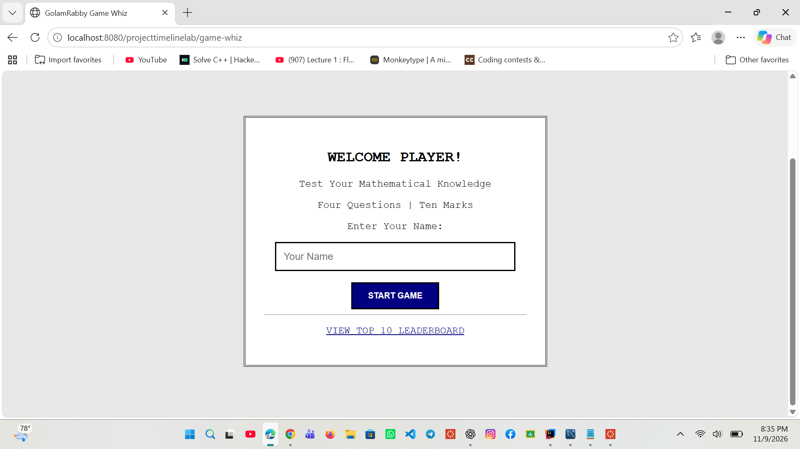
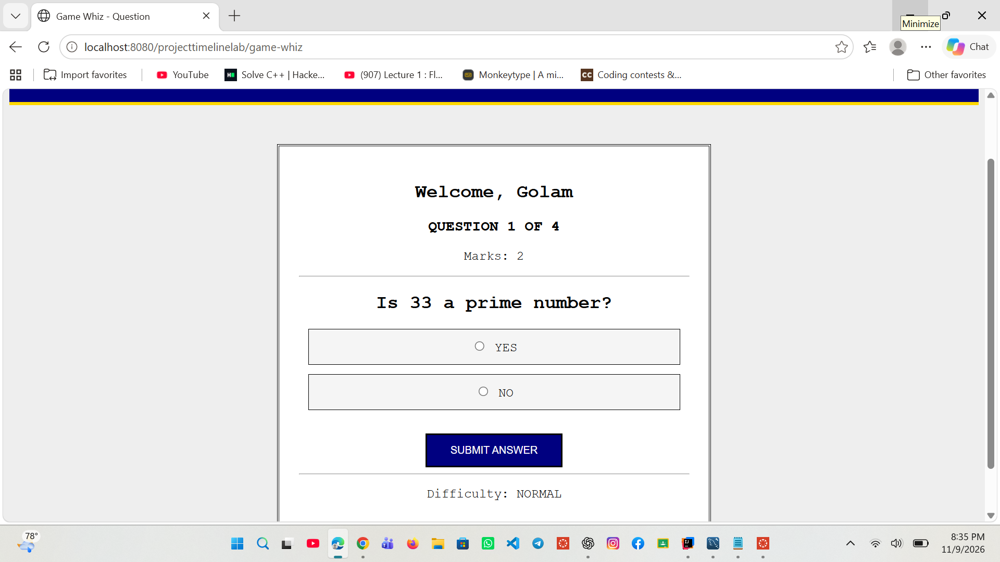
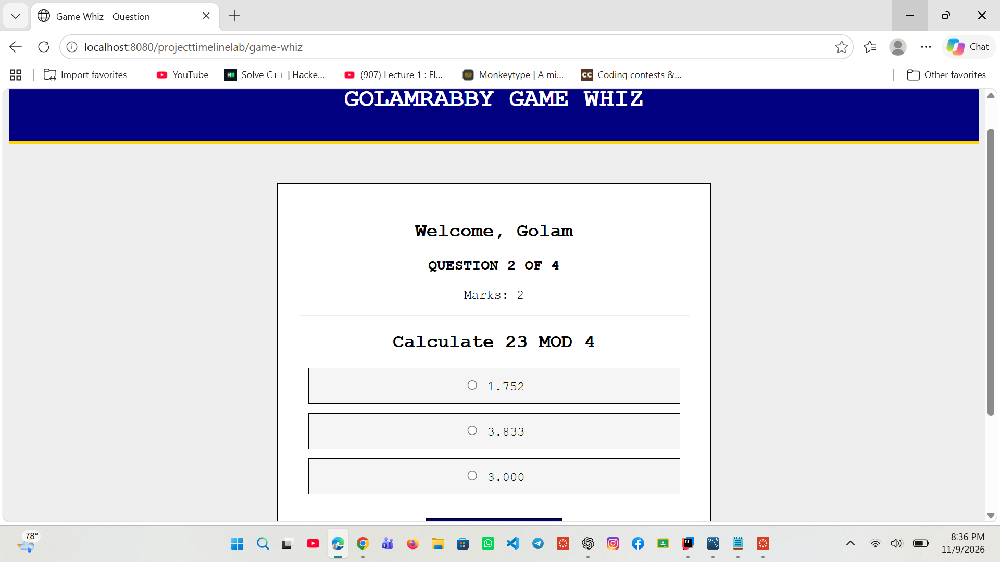
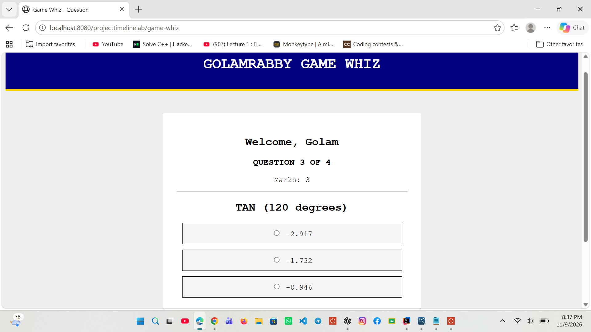
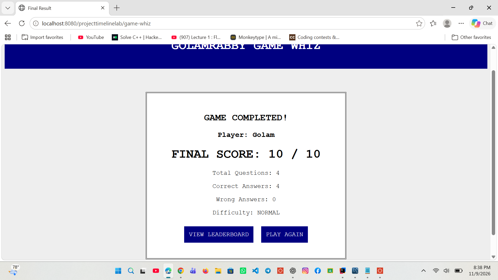
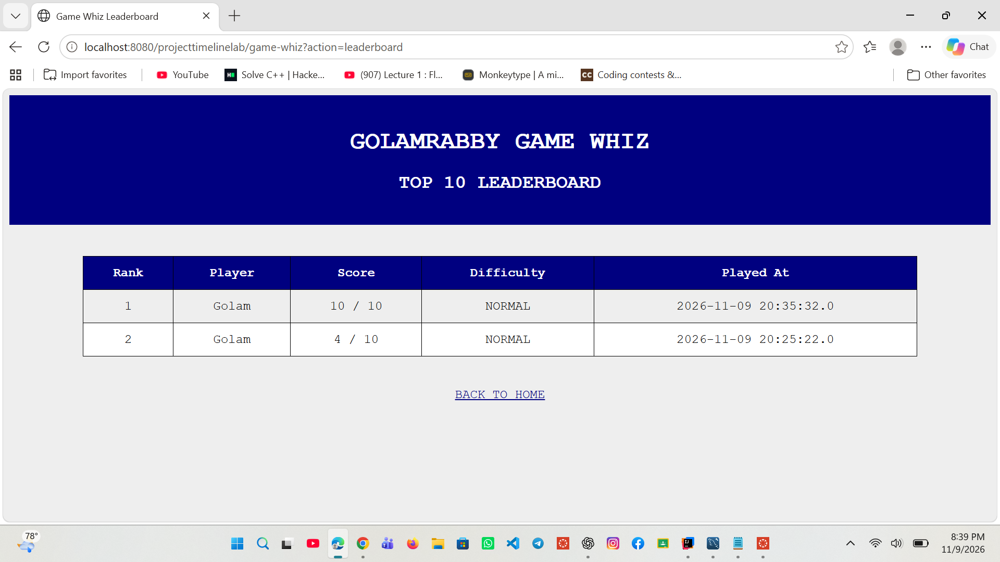
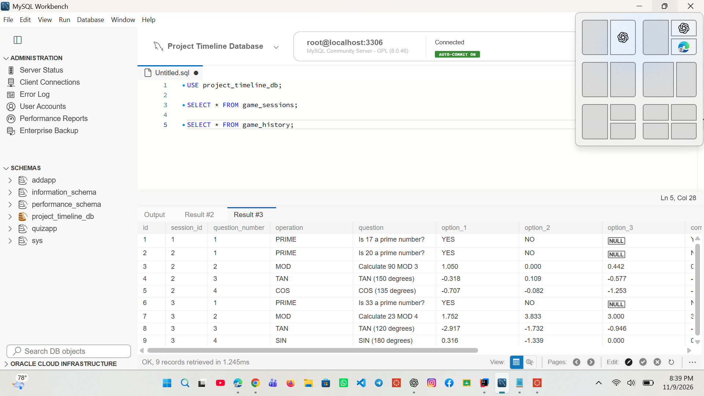

# GOLAMRABBY GAME WHIZ

### Java Web Application Development | Servlet + JDBC

## 1. Project Overview

GOLAMRABBY GAME WHIZ is a web-based mathematical quiz application developed using Java Servlet, JDBC and MySQL.

The application challenges players with four mathematical questions covering Prime Numbers, Modulus Operations and Trigonometry.

Players receive scores based on their answers, and their results are stored in a MySQL database.

## 2. Project Objectives

- Develop reusable mathematical functions using Java.
- Implement server-side processing using Java Servlet.
- Establish database connectivity using JDBC.
- Generate randomized mathematical questions.
- Evaluate player answers automatically.
- Calculate scores out of 10.
- Maintain a Top 10 leaderboard.

## 3. Technologies Used

- Java
- Jakarta Servlet
- Apache Tomcat 10
- MySQL
- JDBC
- HTML
- IntelliJ IDEA
- Maven

## 4. Game Rules

The game contains four questions.

| Question | Operation | Marks |
|---|---|---:|
| Q1 | Prime Number | 2 |
| Q2 | Modulus | 2 |
| Q3 | Trigonometry | 3 |
| Q4 | Trigonometry | 3 |
| Total | | 10 |

### Answer Options

- Prime: YES / NO.
- Modulus: Three options.
- Trigonometry: Three options.

Each question has one correct answer.

## 5. Mathematical Functions

The application implements:

- isPrime(int number)
- calculateMod(int a, int b)
- calculateSin(double degree)
- calculateCos(double degree)
- calculateTan(double degree)

Trigonometric calculations use degrees converted into radians.

## 6. Database Design

Database name: `project_timeline_db`

Tables:

1. game_sessions
2. game_history

The game_sessions table stores player information and final scores.

The game_history table stores individual questions, answer options, selected answers and marks.

## 7. Project Structure

Main Java package:

`com.assignment.projecttimelinelab`

Important classes:

- MathService.java
- GameSession.java
- GameHistory.java
- GameDAO.java
- GameServlet.java
- DatabaseConnection.java

## 8. Application URL

`http://localhost:8080/projecttimelinelab/game-whiz`

## 9. Database Configuration

Configure MySQL connection properties in your Tomcat run configuration:

- db.url
- db.user
- db.password

Do not publish database passwords or private credentials.

## 10. Application Screenshots

### Welcome Page

### Prime Number Question

### Modulus Question

### Trigonometry Question

### Final Result

### Leaderboard

### Database Records

## 11. Author

**Golam Rabby**

Java Web Application Development Lab Project.
